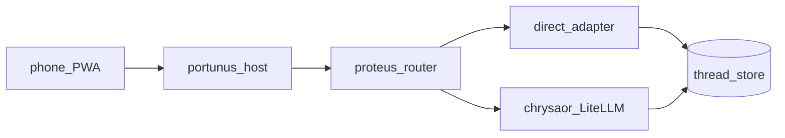

# Iris


[](https://github.com/edwardlthompson/iris/actions/workflows/ci.yml)
[](https://edwardlthompson.github.io/iris/)
[](https://securityscorecards.dev/viewer/?uri=github.com/edwardlthompson/iris)
[](https://www.bestpractices.dev/projects/14564)


**Self-hosted remote for coding agents, with cost-aware routing.** The desktop app is the main way to run it. The phone app and the PWA are the same screens when you are away from the desk.

## Pitch

Your coding agents already live on your desk. Iris puts a phone remote on them — and a cost-aware router in front of every prompt.

Drive Claude, Codex, Cursor, and ACP-capable CLIs from your pocket. Iris runs on *your* machine, pairs over LAN first (Tailscale and tunnels as fallback), and shows the dollar estimate *before* you send. No Iris account. No hosted backend. MIT FOSS, no tracking.

When you opt into pool topology, `chrysaor` fronts LiteLLM on `127.0.0.1` only. Pool keys never sit in Iris. Caps are counted locally. Routing stays transparent: leg, model, effort, estimate — one tap to override.

## Why Iris

- **Desktop window** — the same screens as the phone, with no browser bars. It can start the host, Cursor, and Antigravity, sit in the tray, and show a reply after the window is closed. Windows and Linux share that shell. The PWA is the backup.

- **Cheapest sufficient agent** — `proteus` picks the leg that can finish without overpaying
- **Cost chip before send** — dollars and tokens labelled as estimates, always paired
- **Direct or pool** — per-repo topology; subscriptions work as-is, pools are opt-in
- **ACP unlock** — one adapter reaches many headless CLIs
- **E2EE pairing** — host never listens publicly
- **Ledger that learns** — estimate-versus-actual calibration over time
- **Degrade, never strand** — every dependency has a fallback; threads stay resumable

## Compare

Feature positioning against similar remotes and gateways (not an endorsement). Full competitive ledger: [Appendix E](docs/BUILD_PLAN.md#appendix-e--competitive-ledger).

<table>
  <thead>
    <tr>
      <th>Feature</th>
      <th>Iris</th>
      <th><a href="https://github.com/Suchenl/cursor-remote-lite">cursor-remote-lite</a></th>
      <th><a href="https://github.com/Remotecc-dev/remotecc">Remotecc</a></th>
      <th><a href="https://github.com/siteboon/claudecodeui">Claude Code UI</a></th>
      <th><a href="https://github.com/jainikdroid-bit/opencode-mobile">OpenCode Mobile</a></th>
      <th><a href="https://github.com/getpaseo/paseo">Paseo</a></th>
      <th><a href="https://github.com/slopus/happy">Happy</a></th>
    </tr>
  </thead>
  <tbody>
    <tr>
      <td>Role</td>
      <td>Phone remote + cost router</td>
      <td>Cursor approvals remote</td>
      <td>Pairing remote</td>
      <td>Claude session UI</td>
      <td>OpenCode mobile</td>
      <td>Headless agent daemon</td>
      <td>Mobile agent remote</td>
    </tr>
    <tr>
      <td>Cost-aware routing (proteus)</td>
      <td bgcolor="#1a7f37"><font color="#ffffff">Yes</font></td>
      <td bgcolor="#cf222e"><font color="#ffffff">No</font></td>
      <td bgcolor="#cf222e"><font color="#ffffff">No</font></td>
      <td bgcolor="#cf222e"><font color="#ffffff">No</font></td>
      <td bgcolor="#cf222e"><font color="#ffffff">No</font></td>
      <td bgcolor="#cf222e"><font color="#ffffff">No</font></td>
      <td bgcolor="#cf222e"><font color="#ffffff">No</font></td>
    </tr>
    <tr>
      <td>Transparent $ / tokens before send</td>
      <td bgcolor="#1a7f37"><font color="#ffffff">Yes</font></td>
      <td bgcolor="#cf222e"><font color="#ffffff">No</font></td>
      <td bgcolor="#cf222e"><font color="#ffffff">No</font></td>
      <td bgcolor="#cf222e"><font color="#ffffff">No</font></td>
      <td bgcolor="#cf222e"><font color="#ffffff">No</font></td>
      <td bgcolor="#cf222e"><font color="#ffffff">No</font></td>
      <td bgcolor="#cf222e"><font color="#ffffff">No</font></td>
    </tr>
    <tr>
      <td>Two-stage classifier + policy gate</td>
      <td bgcolor="#1a7f37"><font color="#ffffff">Yes</font></td>
      <td bgcolor="#cf222e"><font color="#ffffff">No</font></td>
      <td bgcolor="#cf222e"><font color="#ffffff">No</font></td>
      <td bgcolor="#cf222e"><font color="#ffffff">No</font></td>
      <td bgcolor="#cf222e"><font color="#ffffff">No</font></td>
      <td bgcolor="#cf222e"><font color="#ffffff">No</font></td>
      <td bgcolor="#cf222e"><font color="#ffffff">No</font></td>
    </tr>
    <tr>
      <td>Direct or pool topology (LiteLLM@localhost)</td>
      <td bgcolor="#1a7f37"><font color="#ffffff">Yes</font></td>
      <td bgcolor="#cf222e"><font color="#ffffff">No</font></td>
      <td bgcolor="#cf222e"><font color="#ffffff">No</font></td>
      <td bgcolor="#cf222e"><font color="#ffffff">No</font></td>
      <td bgcolor="#cf222e"><font color="#ffffff">No</font></td>
      <td bgcolor="#cf222e"><font color="#ffffff">No</font></td>
      <td bgcolor="#cf222e"><font color="#ffffff">No</font></td>
    </tr>
    <tr>
      <td>Local spend caps (not pool-trusted)</td>
      <td bgcolor="#1a7f37"><font color="#ffffff">Yes</font></td>
      <td bgcolor="#cf222e"><font color="#ffffff">No</font></td>
      <td bgcolor="#cf222e"><font color="#ffffff">No</font></td>
      <td bgcolor="#cf222e"><font color="#ffffff">No</font></td>
      <td bgcolor="#cf222e"><font color="#ffffff">No</font></td>
      <td bgcolor="#cf222e"><font color="#ffffff">No</font></td>
      <td bgcolor="#cf222e"><font color="#ffffff">No</font></td>
    </tr>
    <tr>
      <td>Ledger + estimate-vs-actual</td>
      <td bgcolor="#1a7f37"><font color="#ffffff">Yes</font></td>
      <td bgcolor="#cf222e"><font color="#ffffff">No</font></td>
      <td bgcolor="#cf222e"><font color="#ffffff">No</font></td>
      <td bgcolor="#cf222e"><font color="#ffffff">No</font></td>
      <td bgcolor="#cf222e"><font color="#ffffff">No</font></td>
      <td bgcolor="#cf222e"><font color="#ffffff">No</font></td>
      <td bgcolor="#cf222e"><font color="#ffffff">No</font></td>
    </tr>
    <tr>
      <td>Quota-exhausted handoff (v1)</td>
      <td bgcolor="#1a7f37"><font color="#ffffff">Yes</font></td>
      <td bgcolor="#cf222e"><font color="#ffffff">No</font></td>
      <td bgcolor="#cf222e"><font color="#ffffff">No</font></td>
      <td bgcolor="#cf222e"><font color="#ffffff">No</font></td>
      <td bgcolor="#cf222e"><font color="#ffffff">No</font></td>
      <td bgcolor="#cf222e"><font color="#ffffff">No</font></td>
      <td bgcolor="#cf222e"><font color="#ffffff">No</font></td>
    </tr>
    <tr>
      <td>Benchmark table with provenance</td>
      <td bgcolor="#1a7f37"><font color="#ffffff">Yes</font></td>
      <td bgcolor="#cf222e"><font color="#ffffff">No</font></td>
      <td bgcolor="#cf222e"><font color="#ffffff">No</font></td>
      <td bgcolor="#cf222e"><font color="#ffffff">No</font></td>
      <td bgcolor="#cf222e"><font color="#ffffff">No</font></td>
      <td bgcolor="#cf222e"><font color="#ffffff">No</font></td>
      <td bgcolor="#cf222e"><font color="#ffffff">No</font></td>
    </tr>
    <tr>
      <td>Transport ladder (LAN → Tailscale → tunnel)</td>
      <td bgcolor="#1a7f37"><font color="#ffffff">Yes</font></td>
      <td bgcolor="#cf222e"><font color="#ffffff">No</font></td>
      <td bgcolor="#cf222e"><font color="#ffffff">No</font></td>
      <td bgcolor="#cf222e"><font color="#ffffff">No</font></td>
      <td bgcolor="#cf222e"><font color="#ffffff">No</font></td>
      <td bgcolor="#cf222e"><font color="#ffffff">No</font></td>
      <td bgcolor="#cf222e"><font color="#ffffff">No</font></td>
    </tr>
    <tr>
      <td>E2EE pairing / host never public</td>
      <td bgcolor="#1a7f37"><font color="#ffffff">Yes</font></td>
      <td bgcolor="#cf222e"><font color="#ffffff">No</font></td>
      <td bgcolor="#1a7f37"><font color="#ffffff">Yes</font></td>
      <td bgcolor="#cf222e"><font color="#ffffff">No</font></td>
      <td bgcolor="#1a7f37"><font color="#ffffff">Yes</font></td>
      <td bgcolor="#cf222e"><font color="#ffffff">No</font></td>
      <td bgcolor="#cf222e"><font color="#ffffff">No</font></td>
    </tr>
    <tr>
      <td>ACP multi-agent unlock</td>
      <td bgcolor="#1a7f37"><font color="#ffffff">Yes</font></td>
      <td bgcolor="#cf222e"><font color="#ffffff">No</font></td>
      <td bgcolor="#cf222e"><font color="#ffffff">No</font></td>
      <td bgcolor="#cf222e"><font color="#ffffff">No</font></td>
      <td bgcolor="#cf222e"><font color="#ffffff">No</font></td>
      <td bgcolor="#1a7f37"><font color="#ffffff">Yes</font></td>
      <td bgcolor="#cf222e"><font color="#ffffff">No</font></td>
    </tr>
    <tr>
      <td>Degrade, never strand</td>
      <td bgcolor="#1a7f37"><font color="#ffffff">Yes</font></td>
      <td bgcolor="#cf222e"><font color="#ffffff">No</font></td>
      <td bgcolor="#cf222e"><font color="#ffffff">No</font></td>
      <td bgcolor="#cf222e"><font color="#ffffff">No</font></td>
      <td bgcolor="#cf222e"><font color="#ffffff">No</font></td>
      <td bgcolor="#cf222e"><font color="#ffffff">No</font></td>
      <td bgcolor="#cf222e"><font color="#ffffff">No</font></td>
    </tr>
    <tr>
      <td>Self-hosted / no account</td>
      <td bgcolor="#1a7f37"><font color="#ffffff">Yes</font></td>
      <td bgcolor="#1a7f37"><font color="#ffffff">Yes</font></td>
      <td bgcolor="#1a7f37"><font color="#ffffff">Yes</font></td>
      <td bgcolor="#1a7f37"><font color="#ffffff">Yes</font></td>
      <td bgcolor="#1a7f37"><font color="#ffffff">Yes</font></td>
      <td bgcolor="#1a7f37"><font color="#ffffff">Yes</font></td>
      <td bgcolor="#1a7f37"><font color="#ffffff">Yes</font></td>
    </tr>
    <tr>
      <td>Phone-first UI</td>
      <td bgcolor="#1a7f37"><font color="#ffffff">Yes</font></td>
      <td bgcolor="#1a7f37"><font color="#ffffff">Yes</font></td>
      <td bgcolor="#1a7f37"><font color="#ffffff">Yes</font></td>
      <td>Web UI</td>
      <td bgcolor="#1a7f37"><font color="#ffffff">Yes</font></td>
      <td bgcolor="#cf222e"><font color="#ffffff">No</font></td>
      <td bgcolor="#1a7f37"><font color="#ffffff">Yes</font></td>
    </tr>
    <tr>
      <td>Open source</td>
      <td bgcolor="#1a7f37"><font color="#ffffff">Yes</font></td>
      <td bgcolor="#1a7f37"><font color="#ffffff">Yes</font></td>
      <td bgcolor="#1a7f37"><font color="#ffffff">Yes</font></td>
      <td bgcolor="#1a7f37"><font color="#ffffff">Yes</font></td>
      <td bgcolor="#1a7f37"><font color="#ffffff">Yes</font></td>
      <td bgcolor="#1a7f37"><font color="#ffffff">Yes</font></td>
      <td bgcolor="#1a7f37"><font color="#ffffff">Yes</font></td>
    </tr>
    <tr>
      <td>Licence</td>
      <td>MIT</td>
      <td>MIT</td>
      <td>Unverified*</td>
      <td>Unverified*</td>
      <td>Unverified*</td>
      <td>Apache-2.0</td>
      <td>MIT</td>
    </tr>
  </tbody>
</table>

\*Licence unverified in our ledger — verify before copying. Matrix reflects public positioning as of MVP (sprints 0–13).

## How it fits



Phone UI → host daemon → `proteus` → either a direct adapter (your subscription/key) or `chrysaor` → LiteLLM on localhost. Threads land in the ledger either way.

## Quick start

TypeScript · Node 22 · pnpm workspaces · vitest · eslint + prettier · tsup · zod

```bash
pnpm install
pnpm lint
pnpm test
```

GitHub Pages demo: https://edwardlthompson.github.io/iris/

## For agents

| Doc | Role |
|---|---|
| [`docs/STATE.md`](docs/STATE.md) | Last completed sprint, next sprint, blockers |
| [`docs/BUILD_PLAN.md`](docs/BUILD_PLAN.md) | Full work order (Parts A–C + appendices) |
| [`docs/DECISIONS.md`](docs/DECISIONS.md) | Choices made during sprints |

Read `docs/STATE.md`, then execute exactly one sprint from `docs/BUILD_PLAN.md`. Commit on `sprint/NN-slug`. Never continue into the next sprint.

## For humans

Start here, then [`CONTRIBUTING.md`](CONTRIBUTING.md) and [`docs/START_HERE.md`](docs/START_HERE.md). In Cursor: `/tour` or `/coach`.

## Licence

MIT. Bootstrapped from [agent-project-bootstrap](https://github.com/edwardlthompson/agent-project-bootstrap).
