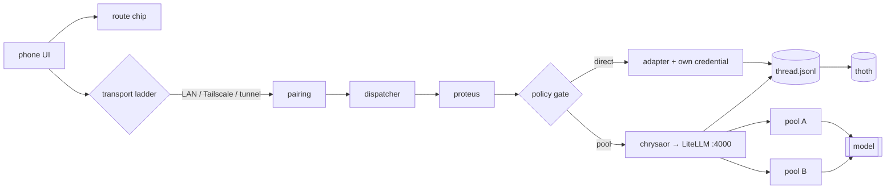

# Product work order

# Iris — build plan

> **For the agent.** This is a work order, not a reading assignment. You will scaffold a repo, then execute numbered sprints in order, one per session, committing after each. Read Part A fully. Read Part B only the sections a sprint points at. Never start a sprint you cannot finish.

**Status:** v2.1 · 2026-11-25 · owner: edwardlthompson  
**Product:** a self-hosted phone remote that runs coding agents on the owner's machine and routes every prompt to the cheapest agent that can actually finish it.

**Why this is a plan and not just a spec:** the owner is token-constrained and may disappear mid-project for days. Every sprint must leave the repo in a state a stranger could resume from. Optimise for resumability over speed.

**Changes in v2.1:** added the pool layer as a first-class topology (§B4a, §B4b) with a new sprint 8 ahead of the classifier. Two topologies now exist — direct and pool — and the user picks. Renumbered 9–18. Added pool health, canonical model IDs, local cap enforcement, and pool acceptance criteria.

---

# Part A — start here

## A1. How to work

1. **Read** `docs/STATE.md` **first.** It names the last completed sprint, the next one, and any blockers. If it does not exist, this is a fresh start: do A2.
2. **Do exactly one sprint per session.** Pick the lowest-numbered sprint not marked done.
3. **Branch, build, test, commit, PR, update** `docs/STATE.md`**, stop.** Never continue into the next sprint.
4. **Never commit to** `main`**.** One branch per sprint, `sprint/NN-slug`.
5. **Do not ask questions.** If a detail is missing, choose the option that keeps the repo working and record it in `docs/DECISIONS.md`.
6. **If a sprint cannot be finished,** stop at the last green commit, mark it `partial` in `docs/STATE.md`, and write the exact next step.
7. **Every sprint ends green.** `pnpm test` and `pnpm lint` pass, or the sprint is not done.

## A2. Bootstrap (sprint 0, always first)

```bash
gh repo create edwardlthompson/iris \
  --template edwardlthompson/agent-project-bootstrap \
  --public \
  --description "Self-hosted phone remote for coding agents, with cost-aware routing" \
  --clone

cd iris
gh repo edit --add-topic remote,self-hosted,pwa,agent,routing,acp,e2ee,llm-gateway
```

Then, before feature work:

- Replace the template README with a short one pointing at this plan.
- Copy this file to `docs/BUILD_PLAN.md`, verbatim.
- Create `docs/STATE.md` from A4.
- Create `docs/DECISIONS.md` with a header and the A2 entries.
- Confirm the template CI runs; fix it if it assumed another stack.
- `git commit -m "chore: bootstrap from agent-project-bootstrap"` and open the first PR.

**Stack, decided here:** TypeScript, Node 22, `pnpm` workspaces, `vitest`, `eslint` + `prettier`, `tsup`, `zod` on every boundary. The phone app is the existing UI copied from `cursor-remote-lite`, not rewritten.

## A3. Sprint index

Sized in rough agent-token cost. Do not skip or reorder. Dependencies are hard.

| # | Sprint | Est. | Depends | Shippable result |
|---|---|---|---|---|
| 0 | Bootstrap | 8k | — | Repo exists, CI green |
| 1 | Protocol + schemas | 20k | 0 | Typed events, validated |
| 2 | Host daemon + pairing | 25k | 1 | Daemon starts, pairs |
| 3 | LAN transport | 15k | 2 | Phone talks to host on LAN |
| 4 | ACP adapter | 30k | 1 | External agent drives a session |
| 5 | Claude adapter | 25k | 1 | Claude Code runs headless |
| 6 | Thread store + replay | 20k | 1 | Sessions recorded, replayable |
| 7 | Ledger + calibration | 15k | 6 | Cost per task measured |
| 8 | Topology + pool layer | 30k | 1, 7 | Direct or pool, LiteLLM front |
| 9 | Stage 1 classifier | 20k | 1, 8 | Local difficulty judgement |
| 10 | Stage 2 + policy gate | 25k | 9 | Venice routing with fallback |
| 11 | Presets + cost chip | 20k | 10 | Price shown before send |
| 12 | Handoff v1, narrowed | 25k | 6, 11 | Quota-exhausted handoff |
| 13 | Benchmark refresh | 15k | 1 | Weekly table refresh |
| — | **MVP cut line** | — | — | **Usable product above** |
| 14 | Antigravity adapter | 25k | 4 | Second IDE leg |
| 15 | Packaging | 20k | 3 | APK, MSI, deb |
| 16 | Fit report | 25k | 7 | Buying recommendations |
| 17 | Shadow → auto | 15k | 16 | Automatic routing |
| 18 | Push + Capacitor | 20k | 15 | Background approvals |
| 19 | Stay paired off LAN | 15k | 3 | Device stays paired; Tailscale then tunnel |
| 20 | Android APK + notify | 25k | 15, 18 | ADB install; shade alerts like the remotes |
| 21 | Antigravity live | 25k | 14, 20 | Phone drives the Antigravity IDE |

**Total ≈ 450k tokens.** Sprints 0–13 are the product. 19–21 are the owner’s current queue: durable pairing off the LAN, an installable Android app with notifications, then Antigravity. If tokens run out, stop cleanly at any boundary.

## A4. `docs/STATE.md`

```markdown
# State

Last completed: sprint N (slug)
Next: sprint N+1 (slug)
Branch in progress: none | sprint/NN-slug
Blockers: none | <exact description>
Notes for the next agent: <what you learned, what to avoid>
```

## A5. Token discipline

- Grep for symbols; don't open whole files.
- Never re-read this document mid-sprint.
- Prefer a stub that runs over a module that doesn't.
- If the owner says "low tokens", do the smallest slice that leaves tests green.
- Write code, not commentary.

## A6. If you only have one session

Sprint 0, then sprint 1, then stop. A typed protocol and green CI is a real handoff.

---

# Part B — spec

## B1. Rules that outrank everything

1. **Transparent routing.** Every decision visible before send: leg, model, effort, estimate, pool. One tap to override.
2. **The host replaces the terminal, not the IDE.** CLI agents run headless as managed children.
3. **The phone UI is not redesigned.** Additive only, matching the two existing remotes.
4. **Local by default.** Code leaves the machine only as prompt text to a provider the user configured.
5. **Free to run.** No account, no hosted backend, unsigned builds preferred.
6. **Show the numbers.** Cost and tokens always visible, labelled estimates, always paired.
7. **Nothing changes silently.** Routing, presets, caps, pools and the benchmark table mutate only by explicit action or reviewed commit.
8. **Degrade, never strand.** Every dependency has a fallback; none leaves a thread unresumable.
9. **Data has provenance.** Every external figure carries source, fetch time, age.
10. **No vendor lock-in.** Iris speaks OpenAI-compatible HTTP only. A provider that needs its own SDK does not get to be a provider.
11. **The user chooses the topology.** Direct or pool. Neither is a downgrade and neither is hidden.

## B2. Naming

**Iris** — Greek messenger goddess, the rainbow bridge between realms. Follows the owner's convention (Argus watches, Janus guards the boot, Hermes carries).

| Path | Name | Role |
|---|---|---|
| `packages/thread` | `ariadne` | Thread store, handoff, continuity |
| `packages/router` | `proteus` | Classification, preset selection, escalation |
| `packages/pool` | `chrysaor` | Pool registry, catalog reconciliation, health, local caps |
| `packages/host` | `portunus` | Daemon, pairing, lifecycle |
| `packages/ledger` | `thoth` | Ledger, calibration, shadow logs |
| `packages/plutus` | `plutus` | Fit report, buying decisions |
| `apps/phone` | — | Client UI, unchanged |

## B3. Architecture



**Transport ladder.** 1 LAN, 2 Tailscale if present, 3 Cloudflare quick tunnel, 4 custom tunnel. First working path wins, active rung shown and pinnable. Host never listens publicly.

**Process limits.** `maxConcurrent` 4, `idleTtl` 90 s, `maxStepsPerTurn` preset-defined, `maxTurnsPerThread` 500.

**Leg runtime.** All CLI agents headless as children. Cursor and Antigravity need their desktop app running.

## B4. Topology

Two topologies, chosen per repo, defaulting to `direct`. They are independent of which legs are enabled.

| | `direct` | `pool` |
|---|---|---|
| Credential | The leg's own (subscription or own key) | A pool key, held by LiteLLM |
| Model choice | Inside the leg | By the router, across the pool catalog |
| Billing | Fixed subscription or direct API | Prepaid balance with a cap |
| Setup | Zero extra | One `chrysaor` config entry |
| Best for | Subscriptions you already hold | Avoiding subscription churn |

**Pool mode puts the pool between Iris and the model, not between Iris and the agent.** Where the agent supports a base URL (`ANTHROPIC_BASE_URL`, `OPENAI_BASE_URL`), the agent is pointed at LiteLLM and still runs normally. Where it does not, the pool is reached through `acp-llm-adapter` with no agent at all.

**Single-leg mode** is `legs: [one]` with routing still choosing model and effort inside it. It composes with either topology.

The mode picked determines pool spending: `savings` spends the pool on the cheapest sufficient model, `max` spends it on the frontier model and climbs. The pool is never asked to beat the preset — it serves it.

## B5. Pools (`chrysaor`)

```ts
interface Pool {
  id: string;                                  // "venice" | "openrouter" | "local"
  baseUrl: string;                             // OpenAI-compatible
  auth: { mode: "pool" | "byok"; keyRef: string };
  discover(): Promise<ModelCard[]>;            // GET /models, cached 24h
  costOf(model: string, tokIn: number, tokOut: number): number;
  limits: { rpm?: number; monthlyCapUsd?: number };
}

interface ModelCard {
  canonicalId: string;   // "claude-opus-5-5"
  poolId: string;
  nativeId: string;      // pool's own string
  ctx: number;
  priceIn: number;       // per 1M
  priceOut: number;
  capabilities: Capabilities;
}
```

**Canonical reconciliation.** `chrysaor` maps every pool's native ID onto one `canonicalId` so a model is one row regardless of who serves it. Unmappable models stay pool-local and are excluded from cross-pool comparison.

**Local caps.** Pools report spend late and inconsistently. Iris counts its own dollars against `monthlyCapUsd` and per-turn preset caps, and stops itself. A pool's own dashboard is a second opinion, never the authority.

**Health.** `chrysaor` probes each pool on load and every 60 s. Two consecutive failures mark it degraded; the router skips degraded pools. Recovery is automatic on the next success.

**Ordering.** Pools are ordered by a user-set preference. The router walks the order and takes the first healthy pool that carries the canonical model at a price inside the preset cap.

**LiteLLM ships as the default front** at `127.0.0.1:4000`, bound to localhost only, with per-key hard budgets. Iris holds pool keys only through LiteLLM, so a pool swap is a YAML edit.

## B6. Adapters

**ACP first.** `packages/adapter-acp` speaks the Agent Client Protocol (JSON-RPC 2.0 over stdio). One implementation unlocks Codex CLI, Gemini CLI, Copilot CLI, OpenCode, Cline, Goose, Qwen Code, Kimi CLI, Mistral Vibe, Junie, Kiro, Factory Droid, Augment, OpenHands, Poolside, Pi, OpenClaw. ACP carries tool calls, elicitation, plans, terminals, modes and cancellation, so `canUseTool` maps nearly 1:1.

Spec https://agentclientprotocol.com · registry https://agentclientprotocol.com/get-started/agents

Native legs: Claude Code (Agent SDK), Antigravity (custom, no ACP), Codex (native SDK), Aider, Cursor (CLI + ACP + IDE bridge), Grok (xAI API via `acp-llm-adapter`).

```ts
interface Capabilities {
  headless: boolean; streaming: boolean; toolApproval: boolean;
  imageInput: boolean; planMode: boolean; modelSelect: boolean;
  effortSelect: boolean; resume: boolean; costReporting: boolean;
  quotaReporting: boolean; worktree: boolean; baseUrlOverride: boolean;
}
```

`baseUrlOverride` gates whether a leg can run in pool mode. Legs without it fall back to `direct` and the chip says so.

## B7. Proteus

Two stages. Stage 1 local regex plus repo state, free and offline. Stage 2 Venice only on `unsure`.

Venice is OpenAI-compatible at `https://api.venice.ai/api/v1`, Bearer auth, Decision model (Clef), discovered at runtime. Strict JSON out.

Overrides beat the classifier: user pin; diff > 400 lines or > 8 files → at least `balanced`; two failures → escalate; math or `debug-hard` → at least `performance`; quota under 15% → one level cheaper or switch provider.

Stage 2 budget 250 ms p95, 400 ms hard, `unclassified` on timeout, cache on prompt prefix + repo + last 2 turns. No second endpoint; backoff and a 5-minute pause after three failures.

Modes `off`, `suggest` (default), `auto`, `shadow`; 20 shadow prompts before `auto`.

Axes `--cost` and `--quota`, never merged.

Privacy: Venice private tier, E2EE + TEE available, `local-only` mode.

`proteus` reads `docs/BENCHMARKS.md` as data, never the network. Invalid table refuses routing; stale table routes with a warning.

## B8. Presets and cost

Reference figures from CursorBench 4.0 (Appendix A), labelled, overwritten by calibration after ~20 runs.

```yaml
savings:     {class: cheap,    default: claude-haiku-5-5,  effort_start: low,    effort_ceiling: medium, steps: 25,  escalate: never,       cap_usd: 0.10, on_cap: stop_and_ask}
balanced:    {class: mid,      default: claude-sonnet-5-5, effort_start: medium, effort_ceiling: high,   steps: 40,  escalate: on_2_fails,  cap_usd: 0.60, on_cap: escalate_or_ask}
performance: {class: frontier, default: claude-opus-5-5,   effort_start: high,   effort_ceiling: xhigh,  steps: 80,  escalate: on_2_fails,  cap_usd: 4.00, on_cap: escalate}
max:         {class: frontier, default: claude-fable-5-2,  effort_start: high,   effort_ceiling: max,    steps: 200, escalate: on_1_fail,   warn_usd: 20.00, hard_cap_usd: 50.00, on_cap: finish_turn_then_stop}
```

Per-leg fallback chains per class. `max` warns at $20, hard-caps at a user ceiling (default $50), never stops mid-tool-call.

Max effort is bad value (Fable 5.2 buys 3.1 points for 3.4×). The frontier is Opus 5.5 high at $3.97/56.0%. `Haiku 5.5 max` at $1.12/48.4% dominates `Sonnet 5.5 high` on both axes.

Grok is in no preset — dominated at every published level. It stays a leg because users are on it.

## B9. Plutus

Local-only spend advisor over `thoth`. Metrics per repo × vendor × domain: completion, $ per success, abandoned spend, escalation rate, rework rate, median turns.

Dominance when B ≥ A on completion and ≤ A on cost outside the CI for two weeks. Advisory only.

Card states both sides, the projection and confidence, with `[Apply] [Keep two vendors] [Not now]`. Tap always required; auto-apply after three acceptances, off by default.

Anti-noise: never pool domains, 20-task gate, two-week signal, one card per repo per week, never recommend a vendor without a key.

In pool mode, `plutus` reports per-pool and per-model, and flags a pool that costs more than the model is worth.

## B10. UI additions

Additive only: route chip (leg, model, effort, estimate, pool), auto badge with override, escalation note, quota meter, cost meter on `max`, leg switcher with disabled reasons, transport indicator, **topology toggle per repo**, **pool indicator on the chip**, pool health dot, cost summary, fit report, stale-data badge.

## B11. Security

X25519 pairing with an out-of-band fingerprint, keys in the OS keychain, authenticated encryption for payloads, outbound-only, SRI pins, per-tool-call approvals, secrets redacted from `thread.jsonl`, deny-by-default filesystem scope, quick-tunnel URLs public.

**Pool-specific:** LiteLLM binds `127.0.0.1` only, never `0.0.0.0`. Pool keys live in LiteLLM's config, not in Iris. Iris never logs a key. A pool outage must not surface a key in an error string.

## B12. Distribution

Unsigned APK via Capacitor plus PWA. iOS PWA first, AltStore later. Windows tray MSI and Linux deb/systemd reuse existing pipelines. Build the UI once, keep platform calls behind an adapter, don't depend on iOS PWA background sockets. LiteLLM ships as an optional component in the MSI and deb, disabled unless pool mode is chosen.

## B13. Data schemas

`thread.jsonl` append-only with monotonic `seq`. `handoff.v1` carries goal, state, constraints, next step, budget. Ledger rows carry `repo_id`, `vendor`, `model`, `preset`, `domain`, `outcome`, `real_usd`, `real_tok`, `escalations`, `rework_count`, and now `topology` and `pool_id`. Provenance block opens `BENCHMARKS.md`. Exact shapes in Appendix C.

## B14. Scope

**v1:** sprints 0–13. **v1.1:** 14–18. **Later:** plugin API, Hub triggers, Tier C legs, team sharing, iOS sideload. **Never:** hosted backend requirement, account requirement, telemetry, UI redesign, model resale.

Local models are backlog: too weak in practice, and they'd need a fourth preset class. Revisit at ~40% on a coding-agent benchmark at usable speed.

---

# Part C — sprint sheets

## Sprint 21 — Antigravity live

<!-- parallel_exception: single blocked row, nothing to parallelize -->

**Goal:** the phone drives Antigravity the way it already drives Cursor.  
**Build:** connect the sprint 14 adapter to the running Antigravity IDE. Legs sheet shows it. Prompts, history, and editor tabs route to that leg when it is selected. IDE closed → leg disabled with a reason; routing continues on the other legs.  
**Done when:** a phone prompt submitted with Antigravity selected appears in the Antigravity desktop session.

---

# Appendix A — CursorBench 4.0, all rows

Fetched 2026-11-25 from https://llmleaderboard.com/benchmarks/cursorbench. Cursor harness, tools enabled. `4.1` rows are a separate track.

| Model | Effort | Score | $/task | Tok/task | Steps |
|---|---|---|---|---|---|
| Gemini 4 Neon | highest (4.1) | 65.4% | n/p | n/p | n/p |
| Claude Fable 5.2 | max | 60.0% | $32.79 | 352,794 | 218 |
| Claude Opus 5.5 | max | 57.8% | $13.43 | 218,363 | 185 |
| Claude Fable 5.2 | high | 56.9% | $9.70 | 99,259 | 69 |
| Claude Fable 5.2 | xhigh | 56.3% | $15.48 | 161,251 | 108 |
| Claude Opus 5.5 | high | 56.0% | $3.97 | 53,078 | 68 |
| Claude Opus 5.5 | xhigh | 56.0% | $6.98 | 101,083 | 109 |
| Claude Sonnet 5.5 | max | 55.5% | $7.05 | 271,920 | 170 |
| Claude Fable 5.2 | medium | 54.8% | $4.66 | 44,103 | 35 |
| Claude Fable 5.2 | low | 53.2% | $3.94 | 36,616 | 30 |
| Claude Sonnet 5.5 | xhigh | 53.1% | $2.81 | 100,158 | 78 |
| Gemini 4 Argon | high | 52.9% | $4.57 | 109,500 | 118 |
| Gemini 4 Argon | medium | 52.8% | $4.39 | 103,600 | 115 |
| Claude Opus 5.5 | medium | 52.5% | $2.91 | 37,954 | 54 |
| Claude Fable 5.1 | max | 51.8% | $17.28 | 117,236 | 128 |
| Claude Fable 5.1 | xhigh | 51.6% | $13.01 | 87,294 | 101 |
| Gemini 4 Argon | low | 50.6% | $4.09 | 94,200 | 110 |
| Claude Fable 5.1 | high | 49.2% | $9.08 | 58,438 | 77 |
| Claude Haiku 5.5 | max | 48.4% | $1.12 | 325,934 | 163 |
| Claude Sonnet 5.5 | high | 47.8% | $1.20 | 37,391 | 41 |
| DeepSeek V4.1 Flash | max | 47.7% | $0.98 | 537,047 | 187 |
| Claude Fable 5.1 | medium | 46.8% | $7.05 | 45,411 | 63 |
| Claude Opus 5 | max | 46.6% | $11.95 | 85,384 | 106 |
| DeepSeek V4.1 Flash | medium | 46.3% | $0.80 | 398,255 | 189 |
| Grok 4.7 | xhigh | 46.3% | $6.01 | 70,141 | 88 |
| Claude Opus 5 | xhigh | 46.1% | $11.43 | 80,094 | 103 |
| DeepSeek V4.1 Flash | high | 45.6% | $0.77 | 385,196 | 186 |
| Claude Fable 5.1 | low | 45.1% | $5.44 | 34,795 | 51 |
| DeepSeek V4.1 Flash | low | 44.9% | $0.60 | 290,651 | 161 |
| Claude Opus 5 | high | 44.7% | $9.00 | 61,405 | 86 |
| Claude Haiku 5.5 | xhigh | 44.3% | $0.56 | 143,813 | 93 |
| Grok 4.7 | high | 43.9% | $4.69 | 56,382 | 71 |
| Claude Opus 5.5 | low | 43.7% | $1.17 | 15,811 | 28 |
| Claude Opus 5 | medium | 43.3% | $6.94 | 45,272 | 72 |
| GLM-5.3 | max | 42.6% | $5.05 | 96,387 | 166 |
| Claude Haiku 5.5 | high | 42.3% | $0.32 | 77,057 | 59 |
| GPT-5.6 Sol | max | 41.7% | $8.23 | 42,944 | 99 |
| Muse Spark 1.3 | max | 41.6% | $2.64 | 52,005 | 98 |
| Grok 4.7 | medium | 41.6% | $3.49 | 36,683 | 60 |
| GPT-5.6 Terra | max | 41.3% | $5.14 | 60,814 | 107 |
| Claude Opus 5 | low | 40.7% | $4.87 | 31,995 | 57 |
| Gemini 3.8 Flash | high | 39.6% | $4.70 | 162,565 | 324 |
| Claude Sonnet 5.5 | medium | 39.2% | $0.52 | 16,036 | 22 |
| GLM-5.3 | high | 38.0% | $3.24 | 60,031 | 114 |
| GPT-5.6 Sol | xhigh | 37.7% | $4.40 | 24,729 | 55 |
| Muse Spark 1.3 | xhigh | 37.5% | $2.10 | 40,891 | 83 |
| Gemini 3.8 Flash | medium | 37.3% | $4.06 | 128,364 | 290 |
| Claude Haiku 5.5 | medium | 36.9% | $0.17 | 42,659 | 39 |
| GLM-5.3-Flash | max | 36.8% | $0.39 | 56,410 | 118 |
| GPT-5.6 Luna | max | 35.9% | $1.03 | 87,284 | 208 |
| Claude Sonnet 5.5 | low | 35.8% | $0.37 | 11,668 | 18 |
| GPT-5.6 Sol | high | 35.7% | $2.85 | 16,174 | 41 |
| Claude Sonnet 5 | max | 34.1% | $7.17 | 149,257 | 140 |
| GPT-5.6 Terra | xhigh | 33.6% | $1.81 | 23,436 | 43 |
| Muse Spark 1.3 | high | 33.4% | $1.66 | 30,654 | 69 |
| GLM-5.3 | low | 33.3% | $2.04 | 31,983 | 81 |
| Grok 4.7 | low | 33.1% | $1.58 | 15,677 | 40 |
| GPT-5.6 Luna | xhigh | 33.0% | $0.44 | 40,598 | 98 |
| Muse Spark 1.3 | medium | 32.6% | $1.49 | 27,255 | 64 |
| Claude Sonnet 5 | xhigh | 32.0% | $4.55 | 83,373 | 102 |
| GLM-5.3-Flash | high | 31.1% | $0.25 | 35,104 | 84 |
| GPT-5.6 Sol | medium | 31.1% | $1.77 | 10,111 | 32 |
| Claude Haiku 5.5 | low | 30.9% | $0.08 | 23,382 | 25 |
| Claude Sonnet 5 | high | 30.8% | $3.48 | 61,146 | 85 |
| GPT-5.6 Terra | high | 30.7% | $1.11 | 13,162 | 33 |
| GPT-5.6 Luna | high | 29.4% | $0.25 | 23,368 | 64 |
| Muse Spark 1.3 | low | 29.3% | $0.93 | 17,483 | 47 |
| Claude Sonnet 5 | medium | 28.0% | $2.31 | 39,114 | 65 |
| GPT-5.6 Terra | medium | 27.6% | $0.64 | 7,307 | 25 |
| GLM-5.3-Flash | low | 26.9% | $0.15 | 17,831 | 58 |
| GPT-5.6 Terra | low | 25.2% | $0.52 | 5,914 | 23 |
| GPT-5.6 Sol | low | 24.6% | $0.87 | 4,885 | 21 |
| Muse Spark 1.3 | minimal | 24.3% | $0.56 | 10,620 | 34 |
| Claude Sonnet 5 | low | 24.1% | $1.39 | 23,772 | 46 |
| GPT-5.6 Luna | medium | 22.2% | $0.08 | 7,642 | 32 |
| GPT-5.6 Luna | low | 16.0% | $0.03 | 3,288 | 18 |

`n/p` = not published. Grok has no max-effort row. Differences under ~1 point between neighbours are noise.

---

# Appendix B — routing implementation

### B1. Stage 1 regex table

Ordered, first match wins, weights summed.

| Pattern                | Signal                  | Weight                      |
| ---------------------- | ----------------------- | --------------------------- |
| `Traceback most recent | ^\s+at .+\(.*:\d+:\d+\) | panic:`                     |
| `Cannot find module    | ModuleNotFoundError     | undefined is not a function |
| `$$                    | bO(n                    | bamortizedb                 |
| `.(test                | spec).[jt]sx?           | pytest                      |
| `and then              | after that              | followed by                 |
| `rename                | extract                 | move .* to                  |
| `README                | CHANGELOG               | comment                     |
| `typo                  | bump                    | version                     |
| `migrat                | schema change           | breaking`                   |
| `why                   | explain                 | how does`                   |

`<= 0` savings, `1–2` balanced, `3–4` performance, `>= 5` max. Opposing signs, or no diff and no files, emit `unsure`.

### B2. Stage 2 system prompt

```
You classify coding prompts for a cost-aware router. Return JSON only.

Presets: savings (cheap, small edits), balanced (routine multi-file),
performance (hard debugging, architecture), max (novel algorithm, deep refactor).

Legs available: {{legs_with_capabilities}}
Topology: {{direct|pool}}

Rules: prefer the cheapest preset that can finish. Raise for ambiguity,
multi-file scope, or math. Lower for docs, typos, version bumps.
Confidence below 0.6 when the prompt is under 12 words or names no files.

Schema: {{schema}}
```

### B3. Thresholds

| Constant | Value |
|---|---|
| `CONFIDENCE_FLOOR` | 0.60 |
| `STAGE2_TIMEOUT_MS` | 400 |
| `CACHE_TTL_S` | 900 |
| `BACKOFF_MS` | 1000, 4000, 15000 |
| `PAUSE_AFTER_FAILURES_S` | 300 |
| `ESCALATE_AFTER_FAILS` | 2 |
| `DEESCALATE_AFTER_CLEAN` | 3 |
| `TOOL_ERROR_WINDOW` | 3 turns, 25% |
| `LARGE_DIFF_LINES` | 400 |
| `LARGE_DIFF_FILES` | 8 |
| `QUOTA_LOW_PCT` | 15 |
| `SHADOW_PROMPTS_REQUIRED` | 20 |
| `POOL_PROBE_INTERVAL_S` | 60 |
| `POOL_DEGRADE_AFTER` | 2 consecutive failures |

### B4. Escalation state machine

```
idle -> classified -> dispatched
dispatched -> escalating  on (fail_count >= 2 | tool_error_rate > .25 | steps > ceiling | user_retry)
escalating -> dispatched  after preset+1, announce once
dispatched -> clean       on turn with no failures
clean(3) -> deescalate    if preset > savings and not max
any -> stopped            on cap or user stop; never mid-tool-call
```

In pool mode, escalation first tries a better model inside the same pool, then a better pool, then a different leg.

### B5. Fixtures

`packages/router/test/fixtures/` — one per domain plus: empty prompt, 900-line diff, stack trace with math, docs-only, `unsure` pair, malformed Venice body, timeout, cache hit. Every fixture asserts a preset or `unsure`.

`packages/pool/test/fixtures/` — stub pool, degraded pool, over-cap pool, unmappable model, duplicate canonical ID across pools.

---

# Appendix C — schemas

`thread.jsonl` envelope: `{v, seq, ts, type, ...}`. Types: `thread.open`, `user.prompt`, `route`, `tool.call`, `agent.text`, `escalate`, `handoff`, `thread.close`. `route` now carries `topology` and `pool_id`.

`handoff.v1`: `{v, thread_id, from{leg,model}, to{leg,model}, reason, goal, state{files_touched,tests,last_error}, constraints[], next_step, budget{preset,cap_usd}}`.

Ledger row: `{thread_id, seq, repo_id, vendor, model, preset, domain, topology, pool_id, stage, confidence, est_usd, real_usd, est_tok, real_tok, escalations, rework_count, outcome, shadow}` with `outcome ∈ pass|fail|abandoned|user_override`.

Provenance block: `{v, source, source_kind, fetched_at, body_sha256, row_count, track, confirmed_by, confirmed_at}`.

Repo config: `{repo_id, topology, legs[], poolOrder[], monthlyCapUsd, presets{...}}`.

---

# Appendix D — refresh job

Weekly cron in `.github/workflows/benchmarks.yml`, runs `scripts/refresh-benchmarks.mjs`. Fetch with UA and 15 s timeout, hash the body, exit if unchanged, parse, guardrail, write with a fresh provenance block, PR.

Guardrails: under 20 rows or a >30% drop; any score outside 5–85; any non-monotonic effort ladder; `usd_per_task` of 0 or above $100; non-`4.0` track quarantined; missing source or timestamp; index count off by more than 3 warns. Any failure opens a `needs review` PR. No partial writes.

No JSON endpoint exists for CursorBench — `llmleaderboard.com/api/benchmarks/cursorbench` 404s on every type; the HTML page is the only route. `benchlm.ai/api/data/leaderboard?category=coding` is a free cross-check with no cost or effort data, CC BY-NC.

Staleness: 30 days shows `est. stale`, 90 days marks presets unverified. Never blocks routing.

---

# Appendix E — competitive ledger

Verify unverified licences before copying.

| Repo / source | Licence | Steal | Verdict |
|---|---|---|---|
| getpaseo/paseo | Apache 2.0 (verified) | Provider registry, worktree isolation, plugin API, headless daemon | Vendor with NOTICE |
| BerriAI/litellm | MIT | Pool front, virtual keys, budgets, fallbacks | Vendor |
| pingdotgg/t3code | Unverified | Mid-thread swap, handoff, thread parity | Mine |
| Remotecc-dev/remotecc | Unverified | Zero-account pairing | Mine |
| siteboon/claudecodeui | Unverified | Session browser, diff viewer | Mine |
| jainikdroid-bit/opencode-mobile | Unverified | No-relay local mode | Mine |
| remotty | Unverified | Mobile-first session UI | Mine |
| lunel-dev/lunel | Unverified | PC-connect flow | Mine |
| slopus/happy | MIT | Baseline UX | Reference |
| claude-squad | AGPL | Worktree orchestration | Reference only |
| Suchenl/cursor-remote-lite | MIT | Cursor approvals, window control | Absorb |
| edwardlthompson/Antigravity-Remote | MIT | IDE driving | Absorb |
| agentclientprotocol/agent-client-protocol | Spec | Permission flow, cancellation | Implement against |
| llmleaderboard.com | Data | CursorBench table | Primary source |
| benchlm.ai | CC BY-NC 4.0 | Composite cross-check | Secondary |
| api.venice.ai | API | Decision models, discovery, E2EE | Classifier + pool |

Retain the MIT notices from both remotes. paseo and LiteLLM need a NOTICE if vendored. claude-squad stays reference-only.

---

# Appendix F — decisions already made

Do not relitigate; record new ones in `docs/DECISIONS.md`.

| # | Decision | Why |
|---|---|---|
| 1 | Transport ladder, LAN first | Tunnels mint a new URL per restart and are rate-limited |
| 2 | `max` warns at $20, caps at a user ceiling, stops at a turn boundary | Mid-tool-call stops strand half-written diffs |
| 3 | No second classifier endpoint | Less surface; Stage 1 covers failure |
| 4 | Screen streaming out of v1 | Heaviest, least used, unrelated to routing |
| 5 | Handoff in v1, narrowed | Quota exhaustion is the binding constraint |
| 6 | `plutus` requires the apply tap | Rule 7; auto-apply after three acceptances |
| 7 | Benchmarks in the empty state only | A yardstick is needed; contamination is not |
| 8 | Scrape, don't poll an API | No endpoint exists; out of process means zero tokens |
| 9 | Local models deferred | Too weak in practice; needs a fourth class |
| 10 | One sprint per session | Resumability beats speed |
| 11 | Topology is a per-repo user choice, default `direct` | Direct works with subscriptions and needs no setup; pool is opt-in |
| 12 | LiteLLM is the default pool front, localhost only | Pool swaps become config, and keys never live in Iris |
| 13 | Caps enforced locally, never trusted to the pool | Pools report spend late and inconsistently |
| 14 | Single-leg mode stays supported | One agent is a legitimate setup, not a degraded one |
